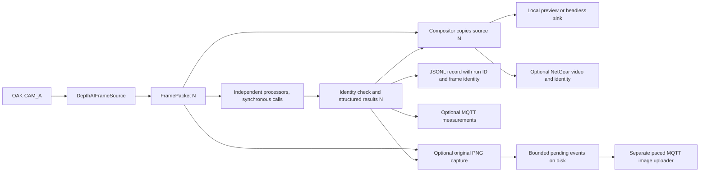

# Shared camera stream

For Aidan's model integration, start with the [computer vision handover](../README.md).
It explains the adapter contract, coordinate mapping and the GCS work still needed.

One OAK-D Lite CAM_A source feeds synchronous processors, then a compositor,
then the local preview. The original image is preserved. The ArUco branch is
connected; Aidan's model and its conditional gauge/valve adapters are not yet
available here. Optional MQTT measurements and VidGear/NetGear video now connect
to a local network demonstration, with a small HTTP bridge for browser viewing.

This implements the local integration structure in
`reports/CV_Subsystem_Integration_Conceptual_Design.md`, particularly sections
6, 11–16. That report is a historical design baseline: its statements that
ArUco and composition are unimplemented are no longer current. This README
and its linked walkthroughs describe the current implementation. For the separate
measurement and video routes, start with [the local network walkthrough](docs/local-network-walkthrough.md).

## Run

After creating the environment, from `Computer Vision/Camera Stream` in this repository:

```sh
.venv/bin/python -B run_camera_stream.py
```

The standalone command defaults to 1280×720 at a requested 30 FPS. The demo
launcher defaults to 1920×1080. Both accept `--profile 720p30` or
`--profile 1080p30` explicitly.
The preview starts at 960×540 and can be resized; this only affects the window,
not the source pixels or camera calibration. Press **q**, **Esc**, or close the
window to stop. Ctrl+C also releases the camera and records interruption.
Only one program can own the OAK at a time; stop the standalone ArUco runner
before starting this one.

For the screen marker measured at approximately **150 mm**:

```sh
.venv/bin/python -B run_camera_stream.py \
  --profile 1080p30 \
  --aruco --permitted-ids 7 \
  --marker-side-length-m 0.15 \
  --calibration '../ArUco Detection/calibration/oak_cam_a.json' \
  --calibration-mode oak-1080
```

For the assignment's physically measured 200 mm square, use `0.20` instead.
Generator settings are not evidence of the size shown on a monitor. The side
length refers to the outer black square, excluding the surrounding white margin.

A bounded run without opening a preview:

```sh
.venv/bin/python -B run_camera_stream.py \
  --headless --max-frames 300 --profile 720p30
```

Add the ArUco options to test processing without a window. A frame limit counts
processed packets, not every sensor exposure. `--output-dir /path/to/new-run`
selects a new evidence directory and refuses to overwrite an existing one.
Default evidence location is `diagnostics/sessions/<UTC>-<unique suffix>` relative
to the working directory. The command works from another directory when given
its full path and the correct Python interpreter; calibration paths remain
relative to your current directory.

## Local network demonstration

```sh
.venv/bin/python -m pip install -r requirements-network.txt
.venv/bin/python -B run_local_demo.py --open-browser
```

The default generates a visibly synthetic ID 7 marker using invented calibration,
runs up to 900 processed frames, and saves evidence in a new
`diagnostics/local-network/` directory. It starts a local aMQTT broker, a JSON
subscriber, a NetGear video receiver with HTTP preview, and the headless sender.
Open `http://127.0.0.1:8080/stream.mjpg` if you omit `--open-browser`. Ctrl+C stops
the processes. Every endpoint stays on the local machine by default.

MQTT sends measurements on `taip/local/results`; NetGear separately sends the
annotated JPEG and identity. Match `(run_id, sequence_number)` between routes.
The default is a software demonstration, not a camera or calibration test.
`--camera` selects the OAK; missing calibration retains detections but withholds
metric pose. See [commands, evidence and the two-terminal walkthrough](docs/local-network-walkthrough.md)
for the hardware options and transport delivery limits.

To view the attached OAK from a phone or laptop on the same LAN, bind only the
HTTP viewer to this Mac's Wi-Fi address:

```sh
.venv/bin/python -B run_local_demo.py \
  --camera --profile 1080p30 --http-host 10.88.38.220 --max-frames 18000
```

Open `http://10.88.38.220:8080/stream.mjpg` on the other device while the command
runs. `10.88.38.220` was this Mac's address on 8 October and may change; check it with
`ipconfig getifaddr en0` (`en0` is the current Wi-Fi interface on this Mac).
MQTT and NetGear stay on loopback; `--http-host` exposes only the plain,
unauthenticated HTTP viewer on the selected concrete IPv4 interface. Use it on
a trusted LAN, without internet forwarding. See the
[LAN viewing steps and connection checks](docs/local-network-walkthrough.md#view-the-oak-from-a-phone-or-laptop)
for firewall and guest-network considerations. Viewing from another device
still needs to be checked on that device.

The report's proposed deployment broker remains Mosquitto. The local launcher
uses aMQTT after the attempted Homebrew Mosquitto install failed on a dependency.
The final team's broker, remote processing deployment and full UI still need integration.

## GCS logs and detection images

Lachlan's GCS accepts MQTT logs on `gcs/drone_log` and image events on
`gcs/detection`. Its test broker is `10.88.35.39:1883`. The existing HTTP video
link remains independent. With the camera demo running, preview adapted logs
in a second terminal:

```sh
.venv/bin/python -B run_gcs_forwarder.py --timeout-s 30
```

To publish sampled ArUco logs, explicitly select the destination:

```sh
.venv/bin/python -B run_gcs_forwarder.py \
  --publish --broker 10.88.35.39 --port 1883 \
  --interval-s 5 --timeout-s 600
```

For automatic original images, add `--capture-detections` to the camera/demo
command, then run `run_gcs_image_forwarder.py` against the printed detection
capture queue. Capture is once per ArUco sighting, with a confirmation period,
an absence grace period and a cooldown. The uploader uses the GCS image schema
and limits image size and upload rate; the capture step bounds its pending queue.
Use `--publish-timeout-s 60 --timeout-s 0` for a 60-second image acknowledgement
wait and continued operation until Ctrl+C. The default runtime remains 600
seconds. Startup and periodic status show the selected folder, destination and
pending work; point each new camera run's uploader at its new capture directory.
Connections that fail before publication are retried with a delay; an upload
with uncertain delivery is recorded as failed and is not replayed automatically. See
[automatic sighting images](docs/gcs-integration.md#automatic-images-one-per-aruco-sighting)
for commands and what these limits mean.

The exact outer log schema remains `{action, content}`. `content` is readable
text: marker ID, accepted position in centimetres with camera-relative directions,
image centre in pixels, or a friendly explanation when pose is unavailable.
A footer gives the frame sequence, device monotonic seconds and full run ID;
synthetic results are clearly marked. Actions distinguish `ArUco detected`,
`ArUco detected - pose unavailable`, and `ArUco processing error`.

Logs are sampled at most once per interval and are not an exhaustive target
history. Automatic image `description` uses the same readable summary and
identity footer. Full native evidence stays in local `sender/frames.jsonl` and
capture `*.event.json` sidecars; image bytes, MIME type, timestamp and the
five-field image contract are unchanged. Consumers that previously parsed log
`content` or automatic image `description` as JSON must display them as text.
Structured remote pose widgets or a dedicated event identity field need a
jointly agreed GCS schema. Restart the image uploader to use the new captions;
descriptions already saved in GCS are not rewritten. The log forwarder does not
publish images or sensor telemetry, and gauge results are not integrated yet. See
[the GCS handoff](docs/gcs-integration.md) for examples, original-file image
sending and receiver checks.

## Frame path and ownership



- `depthai_source.py`: owns device, bounded host queue and conversion to BGR.
- `stream_types.py`: source image, sequence number and capture/dequeue timestamps.
- `stream_processing.py`: processor contract, identity checks and composition.
- `stream_aruco.py`: adapter to the existing ArUco library; no second camera.
- `stream_controller.py`: sequencing, timing, stop conditions and cleanup.
- `local_display.py`: window only; no target algorithm.
- `stream_session.py`: incremental results and session manifest.
- `stream_diagnostics.py`: bounded online acquisition statistics.
- `run_camera_stream.py`: configuration and assembly of these components.
- `stream_mqtt.py` and `run_mqtt_subscriber.py`: local JSON measurement transport.
- `stream_video.py` and `run_video_receiver.py`: NetGear video and HTTP preview.
- `run_local_demo.py`: local broker, receiver and sender process lifecycle.
- `stream_detection_capture.py`: once-per-sighting original image and same-frame evidence.
- `run_gcs_image_forwarder.py`: bounded, paced original-image uploads to GCS.
- `synthetic_source.py`: generated source with clearly labelled invented calibration.

A `FrameProcessor` has a unique `name`, `process(packet) -> ProcessingResult`,
and `draw(overlay, result) -> ndarray`. `ProcessingResult` contains the exact
`FrameIdentity`, JSON-safe `data`, and optional typed `annotations` used only
inside the process. Draw functions may modify the compositor's copy and must
return an independent image of unchanged dimensions and dtype.

Every processor receives the **same packet object**. The image write flag is
read-only during processing and restored afterwards; this catches accidental
writes, not deliberately hostile code. No processor may retain or modify it.
The compositor begins with a copy. The existing ArUco renderer makes another
bounded temporary copy to preserve its standalone API; no frame history grows.

## Calibration and accepted results

`--calibration-mode exact` is the default. It uses the file's geometry unchanged;
a size mismatch preserves marker evidence but withholds pose. `oak-1080` explicitly
selects the current pipeline's factory-intrinsics transformation: resize native
3840×2160 calibration to 1920×1080; for 720p, centre-crop by (320,180). This policy
must be rechecked if the sensor/ISP/video configuration changes. Same pixel
shape alone does not prove the same field of view. Hardware validation remains
necessary, particularly for the 720p crop assumption.

The calibration's device MXID must match the opened device. Missing calibration,
unpermitted or duplicate marker IDs, or failed pose checks retain the decoded ID,
source-frame corners, sequence and timestamps, and set `pose` to null with a
reason. Accepted translation uses metres in `camera_optical`: x right, y down,
z forward. Euclidean range differs from z depth when the marker is off-centre.
The default 1 px reprojection limit is provisional, not an accuracy guarantee.

## Timing, logs and failure policy

`frames.jsonl` contains one record per processed/displayed packet, including
empty detections. Each has a run ID, frame sequence, device and host timestamps,
observed image size, branch data and stage timings. ArUco data retains its own
existing schema under `processors[i].data`. Typed annotations/pixels are not
written to the log. `run.json` contains settings, device/software identity,
calibration snapshot and hash, status, counts, timing means and acquisition
summary. It is replaced atomically at startup, metadata updates and shutdown.
On a hard process kill it may remain `running`; JSONL lines already flushed are
still usable (an abrupt failure can leave a partial final line).

- `capture_to_dequeue_ms`: DepthAI-synchronised frame timestamp to application
  queue dequeue. Excludes BGR conversion, CV, preview and network.
- `source_read`: host call duration including waiting and BGR conversion. Do not
  add it to capture-to-dequeue as though they measured disjoint stages.
- `processing`, `composition`, `display`: separate host durations.
- Each processor has its own duration. `iteration_before_logging` excludes JSONL
  writing and the optional MQTT/video output hooks; these synchronous outputs
  still affect subsequent observed throughput.
- Received FPS uses intervals between consumed packet arrivals. It is not a
  claim of sensor delivery, model throughput in isolation, or web frame rate.
- Sequence gaps count missing sensor sequence numbers at the host consumer.
- Mean latency and counts cover the whole run. P95 uses the most recent up to
  **2048** frames, and records its sample count/window size. Full-run P95 can be
  computed offline from the JSONL. Memory does not grow with run duration.

In synthetic mode the timestamp difference measures generated-image construction
using the host monotonic clock. It does not measure camera latency. Both session
and acquisition manifests explicitly label this different measurement boundary.

Unexpected branch exceptions become `PROCESSOR_ERROR`, that branch contributes
no annotations, other branches run, and the frame is marked `partial`. A target's
normal rejection (such as missing calibration) is a completed branch result,
not an execution error. Wrong identities are rejected before rendering. Sink,
composition and camera failures stop the run and create a failed manifest;
cleanup errors do not replace the original streaming exception.

The command times out after 5 seconds without a new camera frame, configurable
with `--source-timeout-s`. Device boot/USB setup itself is governed by DepthAI.
The optional `--max-processing-ms` rejects a branch that exceeds its elapsed
budget **after the call returns**. It cannot interrupt a hung Python/native model
call. There is no invented Pi deadline default: hard cancellation requires a
measured budget and worker isolation in a later integration stage. Headless frame
limits likewise cannot preempt a hung processor. No claim of a hard real-time
pipeline is made.

The host queue holds at most four messages and drops older queued messages when
full. It is not a strict latest-only queue. Slow CV can reduce processed FPS and
increase sequence gaps without changing the requested camera rate. Logs grow on
disk, so use bounded trials and manage saved evidence for long deployments.

## Verification and next integration

```sh
.venv/bin/python -B -m unittest discover -s tests
```

Tests use generated images, actual OpenCV/DepthAI message APIs, and substituted
hardware/window boundaries. They cover source preservation, same-frame fan-out,
stale results, branch errors, resource cleanup, timeouts and evidence writing.
The current suite passes 93 stream tests, 85 ArUco tests and 48 gauge tests
(226 total). Optional network tests include actual loopback MQTT, NetGear and HTTP
connections, complete demo startup/shutdown, and cleanup after a failed sender.
A 600-frame synthetic trial received 600 matching MQTT records and 600 video
frames; the HTTP snapshot and MJPEG identity headers were also checked. This
demonstrates local delivery, not a network performance guarantee. A
synthetic calibrated marker passed through the complete command and produced an
accepted pose and overlay while preserving its original pixels.

On 7 October 2026 the attached OAK completed a 600-frame run at 1280×720 with
600 matching MQTT receipts and 600 received video frames, no sequence gaps,
29.95 measured received FPS, and clean shutdown. Evidence is in
`diagnostics/local-network/camera-lan-verified-04c625f0`. The HTTP listener used
the Mac's LAN interface, `192.168.68.55:8080`; HTTP health and a camera JPEG were
checked from the Mac during the preceding trial. A longer initial run revealed
a SIGINT race during receiver cleanup; a regression test now protects final
evidence writes and that race is fixed. Other-device reachability still needs
confirmation on that device. These trials used no pose calibration and do not
establish operational pose accuracy or Raspberry Pi performance.

When Aidan's interface is available, add a processor adapter that calls his
model on this packet, converts boxes to source pixels, invokes the gauge reader
only for gauge crops and valve processing only for valve candidates, and returns
all their results for the same frame. Do not implement another acquisition loop
or query a “latest frame”. The local MQTT and VidGear adapters now attach after
composition/results. Their deployment schemas, settings and transport health
policy still need team agreement; the local transports and optional LAN viewer
are not the complete team deployment.

For our code review together, start with `docs/stream-walkthrough.md`.
