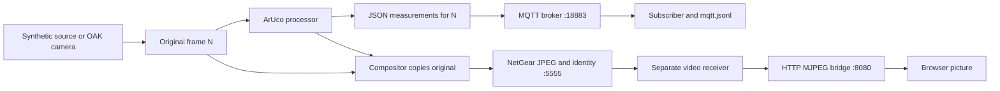

# Follow a frame through the local network demo

This demonstration runs the sender, MQTT broker, measurement subscriber and
video receiver as separate processes on your Mac. It shows how another process
can receive results and video from the same processed frame. Every connection
uses `127.0.0.1` by default. The optional `--http-host` flag lets a phone or laptop
on the same LAN view the HTTP preview. MQTT and NetGear stay on loopback in both
modes. This browser preview does not create the team's full user interface.

The default source is **synthetic**: a generated ID 7 marker, an assumed 200 mm
marker side and invented camera calibration at 1920×1080, requested 30 FPS. The
picture and saved records identify it as synthetic. Its pose demonstrates data
flow, not actual camera distance, calibration accuracy or hardware performance.

## Start here

Use the existing stream environment from this directory:

```sh
cd "Computer Vision/Camera Stream"
.venv/bin/python -m pip install -r requirements-network.txt
.venv/bin/python -B run_local_demo.py --open-browser
```

The launcher prints its new evidence directory and opens
[the local live view](http://127.0.0.1:8080/stream.mjpg). Without `--open-browser`,
open that URL yourself. It starts the broker and receivers before the headless
sender, then stops the child processes when the sender finishes. The default
limit is **900 processed frames**, roughly 30 seconds only if the pipeline
maintains 30 FPS. Ctrl+C stops the demonstration early. The browser stream ends
when the receiver stops; the evidence remains on disk.

For a shorter run, or a directory that is easy to find:

```sh
.venv/bin/python -B run_local_demo.py \
  --max-frames 300 \
  --output-dir diagnostics/local-network/learning-01 \
  --open-browser
```

The output directory must be new. For the next run, omit `--output-dir` to get a
unique timestamped directory, or choose another name. The automatic location is
`diagnostics/local-network/<UTC timestamp>-<unique suffix>`.

## What travels where



**MQTT carries measurements.** The publisher sends strict JSON on
`taip/local/results`: run ID, frame sequence, timestamps, image dimensions,
processing status, per-processor data and timing fields. ArUco results include
decoded IDs, corners and either accepted pose or a rejection reason. Empty
results still describe a processed frame. Pixels and rendered annotations are
not serialized into MQTT.

The MQTT subscriber prints readable summaries and writes each received JSON
object as a line of `mqtt.jsonl`. It announces readiness only after the broker
acknowledges its subscription. The publisher uses QoS 1, waits for the broker's
acknowledgement and does not retain the message. That acknowledgement proves
broker acceptance, not that the subscriber has processed or saved the result.
QoS 1 may deliver duplicates; consumers should recognise repeated frame IDs.
A dropped broker connection or missing publish acknowledgement stops the sender
with an explicit error rather than reporting successful delivery.

**NetGear carries the annotated picture.** The compositor draws onto a copy of
the original image. The sender JPEG-compresses that image and sends it with its
frame identity through VidGear's NetGear/ZeroMQ PUB/SUB transport. The receiver
owns that socket in a separate process. PUB/SUB can drop frames during startup,
overload or shutdown; it does not acknowledge delivery back to the camera.
JPEG is lossy, so received pixels are not an exact copy of the source array.

**HTTP makes the received video visible in a browser.** A small HTTP bridge in
the receiver serves an MJPEG stream. The browser cannot directly consume the
NetGear socket; the bridge exposes the latest received image in a familiar
format. This is a viewing aid, not the future application UI. It retains one
latest HTTP image and does not repeatedly publish a stale frame as new data.

## Match the measurements to a picture

Use **`(run_id, sequence_number)`** as the shared identity. A sequence number by
itself may repeat in a later run. Both routes preserve
`device_timestamp_s`, `host_received_timestamp_s` and `image_size_px` from the
same source packet. For an OAK source, these are the capture/device timestamp
and host dequeue timestamp in the existing pipeline's clock conventions. For
the generated source, they are synthetic timing values; they are not hardware
measurements or wall-clock UTC times.

A browser picture and a terminal's newest JSON line may arrive at different
times. Compare matching identities in the saved receiver and MQTT records;
never pair two records solely because they are the latest on each route.
MQTT and video counts may differ because video can drop frames and QoS 1 can
repeat messages. The original image stays unchanged through processing and
composition; transport starts after the results and output image are formed.

## Watch both routes in two terminals

In terminal 1, start a longer bounded run with a new directory:

```sh
.venv/bin/python -B run_local_demo.py \
  --max-frames 1800 \
  --output-dir diagnostics/local-network/learning-02 \
  --open-browser
```

In terminal 2, change to the same Camera Stream directory, then follow the
subscriber's readable log once the launcher creates it:

```sh
tail -f diagnostics/local-network/learning-02/logs/mqtt-subscriber.log
```

The moving browser image comes from NetGear and HTTP; each `run=... seq=...`
line comes from MQTT. You can also open another independent MQTT subscriber
while the launcher is running:

```sh
.venv/bin/python -B run_mqtt_subscriber.py \
  --max-messages 10 --timeout-s 30
```

Both subscribers receive their own copy of the published measurements. The new
subscriber receives future messages after subscribing, not a replay of earlier
ones. Add `--output /path/to/new-file.jsonl` to save its receipts; an existing
file is never overwritten. Ctrl+C stops `tail -f` independently of the launcher.

## Evidence and viewer endpoints

| Artifact inside the run directory | Meaning |
| --- | --- |
| `sender/frames.jsonl` | Sender records for processed frames, with run and source identity. |
| `sender/run.json` | Sender configuration, calibration, status and timing summary. |
| `mqtt.jsonl` | JSON messages actually received by the measurement subscriber. |
| `receiver/frames.jsonl` | Identity metadata for video frames actually received. |
| `receiver/latest.jpg` | Last received image, saved when the receiver shuts down. |
| `receiver/status.json` | Receiver exit state and most recent frame information. |
| `summary.json` | Launcher summary for this demonstration. |
| `logs/` | Separate process logs for diagnosing startup or runtime failures. |

The launcher verifies that every recorded sender frame has matching MQTT data,
and that the received video frames preserve the sender's identity, timestamps,
dimensions and source label. It requires at least one received video frame; it
does not require every video frame to arrive. `summary.json` records these checks
and the observed counts.

The source label matters: a synthetic record or JPEG is never camera evidence.
Likewise, the receiver returning from its loop is not by itself proof that every
sent frame arrived. Its `ended` status can mean stream termination or an idle
timeout; the launcher's evidence checks separately establish what arrived.

While the demo is running, these are the default localhost URLs. With
`--http-host`, replace `127.0.0.1` with the selected Mac address:

| URL | Response |
| --- | --- |
| [Live stream](http://127.0.0.1:8080/stream.mjpg) | MJPEG video in the browser. |
| [Snapshot](http://127.0.0.1:8080/snapshot.jpg) | Latest fresh JPEG; unavailable before a frame or when stale. |
| [Frame information](http://127.0.0.1:8080/frame.json) | Receiver health and `latest_identity`, including run ID and sequence. |
| [Health](http://127.0.0.1:8080/health) | Receiving/waiting/stale/closed state, age and received count. |

The default ports are MQTT **18883**, NetGear **5555** and HTTP **8080**. Override
them with `--mqtt-port`, `--video-port` and `--http-port` if a port is already in
use. Use the changed HTTP port in the browser and the changed MQTT port with
`run_mqtt_subscriber.py --port ...`. Port switches alone do not enable LAN
viewing; `--http-host` selects the HTTP interface. Neither option moves the MQTT
or NetGear connection away from loopback.

## Switch to the attached OAK

Stop any other program that owns the OAK, then run:

```sh
.venv/bin/python -B run_local_demo.py \
  --camera --max-frames 300 \
  --marker-side-length-m 0.20 \
  --permitted-ids 7 \
  --open-browser
```

Without `--calibration`, decoded IDs and corners are still useful and transmitted,
but metric pose is withheld. Do not substitute the demo's invented calibration.
For the existing OAK calibration and its explicit resize/crop policy:

```sh
.venv/bin/python -B run_local_demo.py \
  --camera --max-frames 300 \
  --marker-side-length-m 0.20 \
  --permitted-ids 7 \
  --calibration '../ArUco Detection/calibration/oak_cam_a.json' \
  --calibration-mode oak-1080 \
  --open-browser
```

Use the **physically measured outer black square** for marker side length; a
150 mm marker needs `0.15`. Calibration must belong to the opened device and
match the frame geometry. `exact` uses the supplied geometry unchanged;
`oak-1080` applies the existing OAK resize/centre-crop policy described in the
main README. That policy and pose accuracy still need physical validation.
Running this command is an optional hardware trial, not evidence that a camera
trial has already succeeded.

## View the OAK from a phone or laptop

Keep the OAK connected to the Mac and run all processing there. On the other
device, the browser receives the HTTP preview; it does not connect directly to
NetGear or MQTT. This step does not send the processor interfaces or measurement
subscription to another teammate's machine.

First read the Mac's Wi-Fi IPv4 address:

```sh
ipconfig getifaddr en0
```

`en0` is this Mac's Wi-Fi interface at setup; on a different machine, use its
actual Wi-Fi interface. The address was `192.168.68.55` when checked and may
change after reconnecting or switching networks. Substitute the current address
in both the command and browser URL:

```sh
.venv/bin/python -B run_local_demo.py \
  --camera --profile 1080p30 --http-host 192.168.68.55 --max-frames 18000
```

Then open [the LAN live view](http://192.168.68.55:8080/stream.mjpg) on your phone
or laptop while the command runs. The frame limit is 18000 processed frames,
roughly ten minutes only if the pipeline maintains 30 FPS. Ctrl+C on the Mac
stops the run sooner. Without calibration, the camera run still detects marker
IDs and corners but withholds metric pose; add the calibration options from the
previous section when appropriate for your camera and marker.

Both `run_local_demo.py` and `run_video_receiver.py` accept `--http-host`. The
default is `127.0.0.1`. For LAN viewing, supply the Mac's concrete IPv4 interface
address; wildcard addresses such as `0.0.0.0` are not supported. The HTTP server
binds only to that configured address. Use that address even when viewing from
the Mac itself, because the LAN binding does not also create a localhost
listener. MQTT remains at `127.0.0.1:18883` and NetGear at `127.0.0.1:5555`.

The demo launcher accepts `--profile 1080p30` (1920×1080, the current default)
or `--profile 720p30` (1280×720), and passes it to the camera sender. Both request
30 FPS; actual throughput is recorded in the sender's diagnostics. No source
edit is needed to switch resolution. The browser URL stays the same.

Before restarting, press Ctrl+C once in the launcher terminal and wait for the
shell prompt. If startup reports an occupied port, inspect its owner with
`lsof -nP -iTCP:18883 -sTCP:LISTEN`. An interrupted or forcibly closed launcher
can leave a child behind. Confirm that it belongs to the old demo before
stopping that specific PID; do not terminate every Python process or change
ports to bypass a camera session that is still running.

If the other device cannot show the picture:

- Confirm that the launcher is still running and that both devices are on a
  reachable LAN. Guest Wi-Fi or client isolation can block device-to-device
  traffic even when both devices have internet access.
- Recheck the Mac's address, then try `http://192.168.68.55:8080/health` using the
  current address. If macOS asks whether Python may accept incoming connections,
  allow it for this intended LAN viewer.
- Try `http://192.168.68.55:8080/snapshot.jpg` using the current address to check
  a single fresh frame. An unavailable snapshot can mean no frame has arrived
  or the latest frame is stale; inspect health and the receiver log.
- If you changed `--http-port`, use that port in every browser URL.

The HTTP preview is plain and unauthenticated: anyone who can reach that
interface and port can view it while it runs. Use a trusted LAN and do not
forward the port to the internet. The optional LAN binding enables this path;
successful viewing on a second device remains to be checked on that device.

## Broker choice and scope

The subsystem report proposes **Mosquitto**. This local launcher currently uses
**aMQTT 0.11.3** inside the Python environment because the attempted Homebrew
Mosquitto installation failed while handling its CA-certificate dependency.
Paho still speaks standard MQTT, so the publisher and subscriber are not tied
to aMQTT. The final team's broker choice, deployment configuration, authentication,
network topology and UI integration remain future work.

`requirements-network.txt` pins the installed transport versions separately
from the camera-only dependencies. The `setuptools` pin provides the
`pkg_resources` API used by VidGear 0.3.3. Network imports are lazy in the camera
runner, so the existing local camera path does not require MQTT or NetGear.

To inspect the implementation, read `run_local_demo.py` for process startup and
shutdown, `run_camera_stream.py` for the two output adapters, `stream_mqtt.py`
and `run_mqtt_subscriber.py` for measurements, then `stream_video.py` and
`run_video_receiver.py` for video and the browser bridge. The earlier
[stream walkthrough](stream-walkthrough.md) explains capture, processors and
composition before these outputs.
