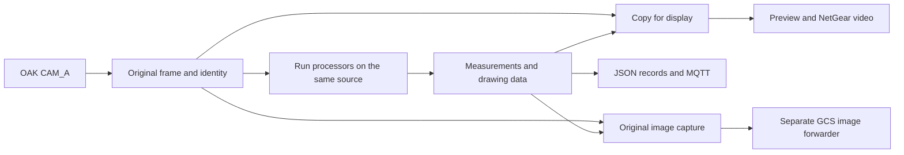

# Computer vision handover

Start here, Aidan. The camera stream, ArUco reader, gauge reader and network
outputs are in this folder. The shared stream already runs ArUco on live frames.
The next integration step is to connect your detection model, then send suitable
gauge crops to the existing gauge reader.

Keep `Camera Stream`, `ArUco Detection` and `Gauge Reader` together. Some imports
use these sibling paths. Create a new Python environment on your machine rather
than copying the Mac's `.venv` folder.

## What is connected already

| Part | Current state | Start reading here |
| --- | --- | --- |
| Camera and frame loop | One OAK CAM_A source, shared processing, preview and run records | [run_camera_stream.py](Camera%20Stream/run_camera_stream.py), then [stream_controller.py](Camera%20Stream/stream_controller.py) |
| Processor interface | A common input and result format for each detector | [stream_processing.py](Camera%20Stream/stream_processing.py) |
| ArUco | Detection, calibrated pose, rejection reasons and overlays are connected | [stream_aruco.py](Camera%20Stream/stream_aruco.py), then [ArUco README](ArUco%20Detection/README.md) |
| Gauge values | Crop reader works independently; the shared stream still needs a model to find and pass gauge crops | [gauge_reader.py](Gauge%20Reader/gauge_reader.py), then [gauge_types.py](Gauge%20Reader/gauge_types.py) |
| Live video | NetGear sends annotated frames; an HTTP bridge makes them viewable in a browser | [stream_video.py](Camera%20Stream/stream_video.py), [run_video_receiver.py](Camera%20Stream/run_video_receiver.py) |
| GCS logs and photos | ArUco mapping and one image per sighting are implemented; model detections need their own mapping | [gcs_output.py](Camera%20Stream/gcs_output.py), [stream_detection_capture.py](Camera%20Stream/stream_detection_capture.py) |

There is no general model loader or valve-reading adapter connected yet. Model
weights, class names, preprocessing and inference dependencies need to come with
your model. The existing gauge defaults describe a 0–10 bar dial; they are not
automatically correct for every gauge your detector might find.

## How a frame moves through the system



Processors currently run one after another in the same frame loop. Each sees
the original image. The compositor draws their results on a separate image so
annotations never become input to another detector or end up in the saved
original photo.

The camera profiles request 30 FPS. That does not guarantee 30 model results per
second: inference, drawing and output work all take time. The processing budget
is checked after a processor returns; it cannot interrupt a hung model call.
Measure throughput again once your model is connected.

## Connect the model

An adapter is a small class joining your model to the frame loop. Follow
`ArUcoProcessor` as the working example and the `FrameProcessor` interface as the
contract.

1. Give the adapter a unique, nonempty `name`, such as `object_detector`. Load
   the model once when constructing it, rather than once per image.
2. Implement `process(packet)`. Prepare any RGB, resized or cropped input from
   `packet.image`, run inference and map the detections back into the original
   frame's pixels.
3. Return a `ProcessingResult` using your adapter name and
   `FrameIdentity.from_packet(packet)`. Put JSON-compatible measurements in
   `data` and any local drawing objects in `annotations`.
4. Implement `draw(overlay, result)`. Draw on the supplied overlay and return it,
   preserving its size and data type. It already contains earlier processors'
   annotations. Do not draw on the original `packet.image`.
5. Construct and append the adapter in the `processors` list in
   `run_camera_stream.py`, alongside the existing ArUco registration. That list
   is the actual connection point; adding a Python file alone does not enable it.

If your model owns a worker, device or other resource, construct it inside a
persistent `ExitStack` and register its cleanup there. Use a dedicated model
stack or the runner's `transports` stack. Do not use the `resources` stack for
model cleanup: `pop_all()` detaches its callbacks when ownership of the camera
and display passes to the controller. The processor interface does not call
`close()` for you, and cleanup must also cover a failed startup.

The synthetic path currently expects ArUco to be enabled and first in
`processors`: it assigns invented calibration to `processors[0]` and updates
ArUco metadata. Keep ArUco enabled and first when adding a model to the demo, or
update both assumptions before supporting a model-only synthetic run.

If model options are added to the runner's command line, also forward them from
`run_local_demo.py`. The demo builds an explicit subprocess command; it does not
automatically pass through new arguments.

### Input and output rules

| Item | What the adapter should use |
| --- | --- |
| Source image | NumPy BGR image, indexed as `[row, column]` or `[y, x]`; shared input is read-only during processing |
| Image shape | `(height, width, channels)`; metadata `image_size_px` is `(width, height)` |
| Image coordinates | Original source pixels, with `(0, 0)` at the top left, positive x right and positive y down |
| Frame identity | Preserve sequence number, device time, host receipt time and source dimensions from the incoming packet |
| Run identity | The runner adds `run_id`; match `(run_id, sequence_number)` across video, results and photos |
| JSON data | Ordinary dictionaries, lists, strings, finite numbers, booleans and `None`; convert NumPy values and model tensors before returning |
| Drawing data | `annotations` can hold local objects; this field is not included in the JSON record |

Undo model resizing and letterbox padding before reporting coordinates. A box
on a 640-pixel model input cannot be drawn directly onto a 1920-pixel camera
frame. Keep the source identity even when inference uses a different-sized copy.
Device and host receipt times are clock values in seconds, not calendar dates.

For the new model's `data`, agree on class names, confidence meaning and a box
format before connecting the GCS. For example, if using `bbox_xyxy_px`, document
it as `[left, top, right, bottom]` in source pixels. That is a proposed model
record convention, not a field the current ArUco reader already produces.

### Pass gauge candidates to the reader

Run the detector first, then call `read_gauge` inside the same adapter for each
gauge candidate. Separate processors do not receive each other's results.

`read_gauge(crop, metadata=...)` accepts an image of one candidate gauge. Keep a
candidate identifier and the frame identity in its metadata. Consume `value_bar`
only when `valid` is true; retain rejected results and their `failure_reason`
for diagnosis.

The returned `centre`, `tip` and `radius` already refer to the input crop, with
the reader's internal resizing undone. To draw them on the full frame, add the
crop's left/top origin to the centre and tip. For a crop starting at `(300, 120)`,
a returned centre of `(40, 50)` belongs at `(340, 170)` in the full frame. The
radius does not change when adding that offset. Crop from the original frame
after mapping the detector's box back to source pixels.

Review `GaugeCalibration` for the actual dial: its current defaults are 0–10 bar,
a clockwise 270-degree sweep, zero at 225 degrees and full scale at 135 degrees.
Angles are measured clockwise from up. A valve state needs a separate agreed
reader and result meaning.

## Understand acceptance and failure

The frame's `status="complete"` means its processor calls completed without a
branch failure. It does not mean every detected object's measurement was
accepted. Check each object's `valid` and `failure_reason` as well.

ArUco can identify a marker and retain its corners, sequence and timestamps while
withholding `pose`. Missing calibration, an unpermitted ID or excessive pixel
error are examples. An empty `results` list means no decoded markers in that
processed frame. Neither case should be replaced with a made-up distance.

Accepted ArUco translation is in metres in the `camera_optical` frame: x right,
y down and z forward. The z value is forward depth, not the straight-line range
to an off-centre marker. `rotation_vector_rad` is an axis-angle rotation vector,
not yaw, pitch and roll. Reprojection error measures pixel fit; it does not prove
physical distance accuracy.

A processor exception becomes a structured branch failure so the other branches
can still report. A drawing, display or output failure can stop the run. Inspect
the saved records when a stream stops rather than assuming inference failed.

## Connect the model results to Lachlan's side

The live picture and MQTT records take different routes. NetGear carries video
to the receiver. The browser reads the receiver's HTTP stream. MQTT carries
measurements and GCS messages; using the same port alone does not connect these
routes.

The current GCS log formatter and automatic photo capture select the `aruco`
processor. A new model result will be included in native frame records, but it
will not automatically become a GCS log or detection photo. Extend these points
as a separate, tested integration step:

- `gcs_output.py`: turn the model's accepted and rejected results into readable
  action/content text and image descriptions.
- `stream_detection_capture.py`: define which classes trigger a sighting and
  when that sighting ends. ArUco IDs provide identity today; a model class label
  alone does not distinguish two separate objects of that class.
- `run_gcs_forwarder.py` and `run_gcs_image_forwarder.py`: retain their pacing,
  queue limits and delivery records when adding model events.

Automatic captures save a full-resolution original PNG and a companion event
record. The event file is written last so the uploader knows the capture is
ready. The GCS image payload uses `type`, `description`, `mime`, Base64 `image`
and `timestamp`. Thumbnail sizing belongs in the dashboard display.

The photo forwarder watches one fixed `--capture-dir`. Every new camera run has
a new directory, so point the forwarder at the path printed for that run. Use
`--timeout-s 0` to keep it running until Ctrl+C. A broker acknowledgement confirms
the broker accepted the message; it does not confirm database storage or gallery
display. See the [GCS integration guide](Camera%20Stream/docs/gcs-integration.md)
for exact commands, queue states and retry handling.

## Run and check the handover

Use Python 3.12 for the existing pinned environment. From `Computer Vision`:

```sh
cd "Camera Stream"
python3.12 -m venv .venv
.venv/bin/python -m pip install -r requirements-network.txt
```

Start with the software-only local demo. This needs no camera or teammate's
broker and uses an invented scene and calibration:

```sh
.venv/bin/python -B run_local_demo.py --max-frames 60 --open-browser
```

For a longer look, increase `--max-frames`. The browser endpoint is
`http://127.0.0.1:8080/stream.mjpg`. The camera instructions and same-network
viewing setup are in the [stream README](Camera%20Stream/README.md) and
[local network walkthrough](Camera%20Stream/docs/local-network-walkthrough.md).
Only one process can own the OAK camera at a time.

The saved OAK calibration belongs to the camera identified in that JSON file.
Use calibration for the actual camera and stream geometry. The assignment marker
is 200 mm; our monitor test used a measured square of approximately 150 mm.
Use the physical outer black-square size, not the generator's requested size.

Run the current camera-free checks from their own folders:

```sh
# From Computer Vision/Camera Stream
.venv/bin/python -B -m unittest discover -s tests

cd "../ArUco Detection"
PYTHONPATH="../Camera Stream" "../Camera Stream/.venv/bin/python" -B -m unittest discover -s tests

cd "../Gauge Reader"
"../Camera Stream/.venv/bin/python" -B -m unittest discover -s tests
```

When adding the model, check an empty scene, several objects, a failed inference,
coordinate mapping after resize/crop and preservation of the original pixels.
Use a known model output first to test the adapter independently of model quality.

## Where to look when something is wrong

The local demo prints a new directory under
`Camera Stream/diagnostics/local-network/`. Its `sender/frames.jsonl` contains
one JSON record per processed frame, including identity and branch results.
`processors` is a list. Select its entry whose `processor` is `"aruco"`, then
read `entry["data"]["results"]`. Standalone ArUco commands have a different outer
record; their evaluation tool should not be given shared-stream records unchanged.

When `--capture-detections` is enabled, the demo's `sender/detections/` holds
original images, event records and uploader receipts. `pending=0, failed=3`
means that folder has three failed events and nothing waiting to send.
It does not mean new images are arriving. Check the
directory, event reasons and the separate photo forwarder's destination first.

For a guided explanation, use the [stream walkthrough](Camera%20Stream/docs/stream-walkthrough.md).
The [hardware benchmark](../Hardware%20Diagnostics/OAK-D-Lite/README.md) is a
separate evidence tool for USB/camera trials, not the application entry point.
Its archived measurements should remain unchanged during model integration.
